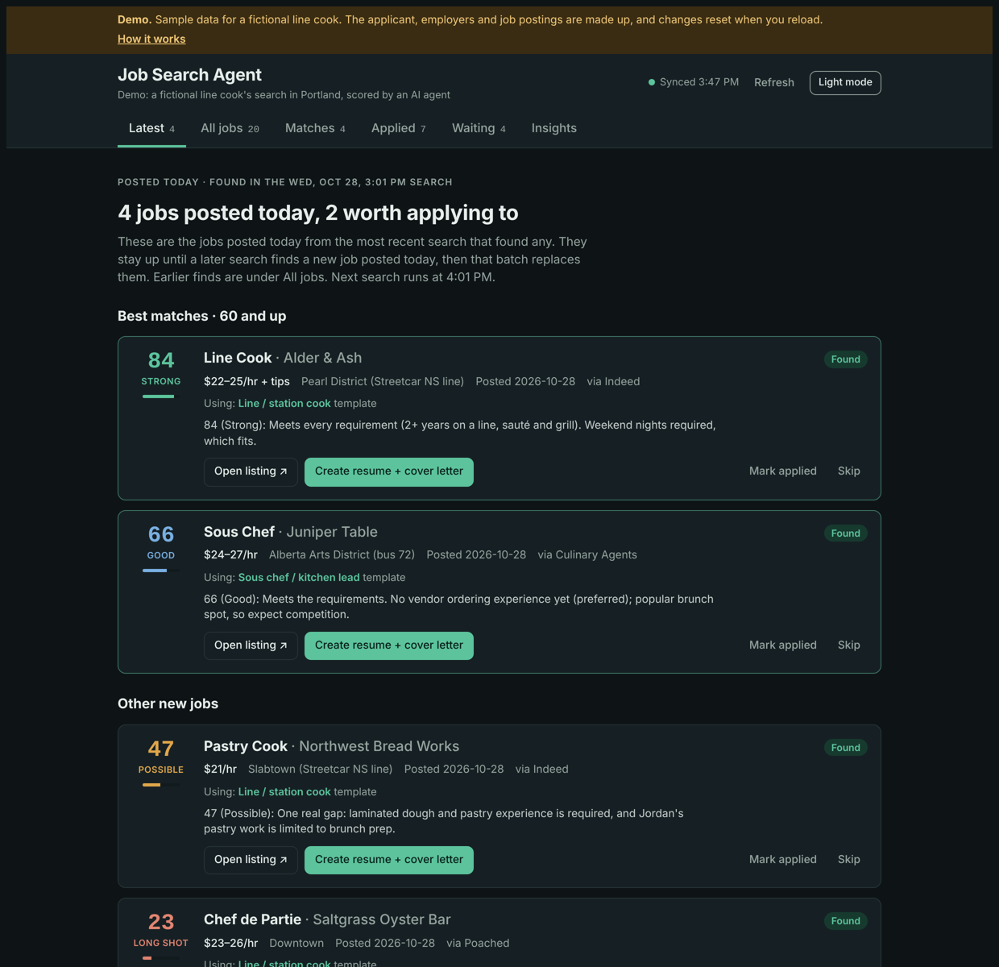
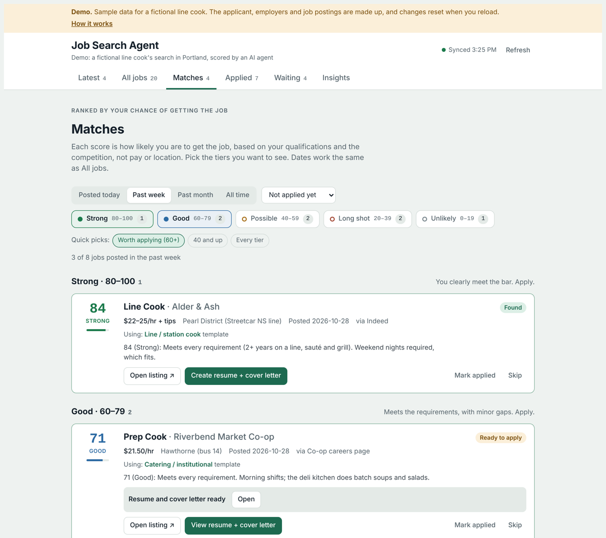
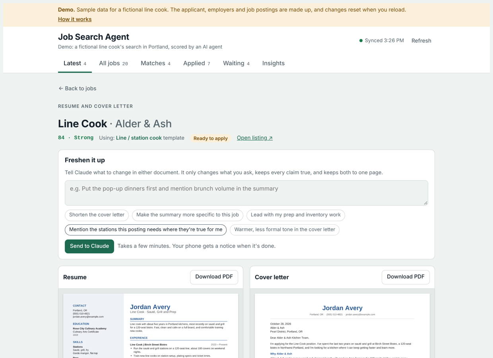
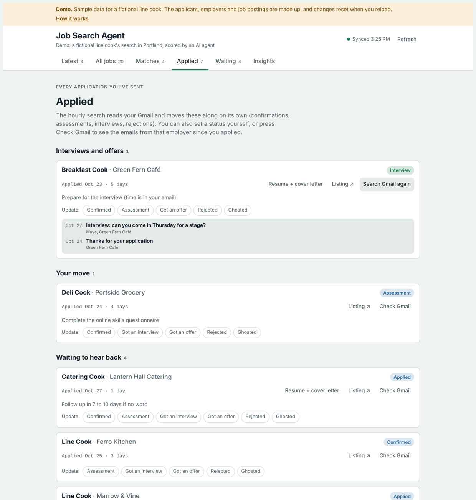
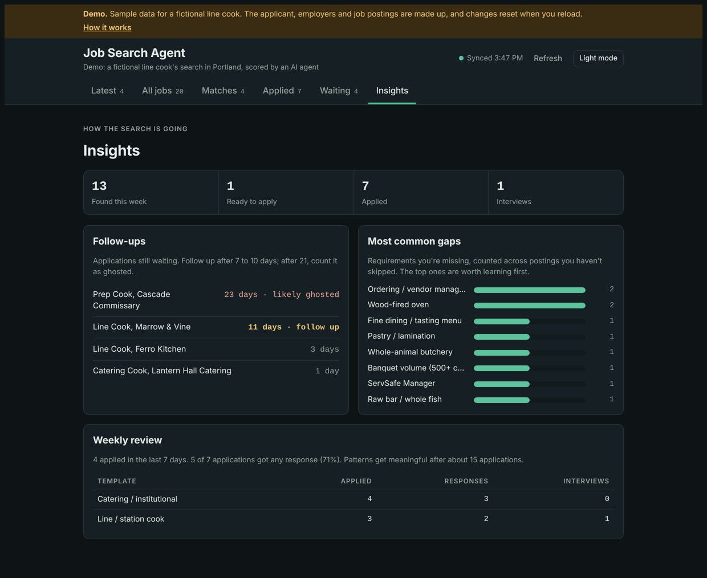
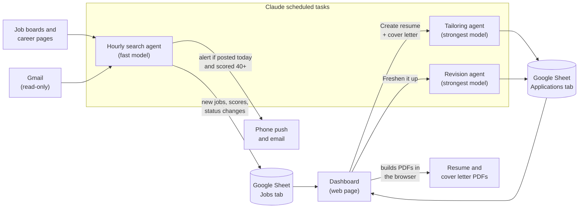

# Job Search Agent

An AI agent pipeline that searches for jobs every hour, scores how likely the applicant is to get each one, writes a tailored resume and cover letter on request, and tracks every application on a web dashboard.

**[Try the live demo →](https://aaron-underhill.github.io/job-search-agent/)**

The demo runs on sample data for a fictional line cook, Jordan Avery. Every applicant, employer and job posting in it is made up. The real version runs privately on my own search for a first tech job.



## What it does

- **Searches every hour.** A scheduled AI agent checks job boards, employer career pages and job-alert emails, then applies hard filters: pay floor, transit-reachable location, title level, required years.
- **Scores each job honestly.** Every job gets a 0–100 *hiring likelihood* score: how likely the applicant is to actually get it, based only on qualifications and competition. The score comes with a one-line reason that names every gap.
- **Alerts on what matters.** A phone and email alert goes out only when a job that was posted *today* scores 40 or higher, or when an application reaches the assessment, interview or offer stage.
- **Tailors applications on request.** One button starts a second agent. It reads the posting, researches the employer, picks a resume template and adapts it to the job, without claiming anything the applicant hasn't done. It also checks that both documents fit on one page.
- **Takes edits.** In the "Freshen it up" box you type a request like "shorten the cover letter", and a revision agent applies it and logs what changed.
- **Tracks applications.** Statuses move forward automatically from Gmail (read-only): confirmed, assessment, interview, offer, rejected. Follow-ups are flagged after 7 days and likely-ghosted applications after 21.

| Matches by score tier | Tailored resume and cover letter |
| --- | --- |
|  |  |

| Applications and Gmail check | Insights |
| --- | --- |
|  |  |

## How it works



1. **The rules live in one skill file** ([`agent/SKILL.md`](agent/SKILL.md)): the applicant's profile, target roles, filters, the scoring rubric, the resume templates, the truth rules and things the agent must never do. Every agent follows it.
2. **The hourly search agent** ([`agent/hourly-search.md`](agent/hourly-search.md)) runs at 1 minute past every hour in the cloud, so it keeps going when my laptop is closed. It writes to a Google Sheet. That sheet is the single source of truth.
3. **The dashboard** ([`index.html`](index.html)) reads the sheet. The live version runs as a private Claude artifact, which can call my connected Google Sheets, Gmail and scheduled tasks. The page has six views:
   - **Latest:** jobs posted today.
   - **All jobs:** filtered by posting date.
   - **Matches:** filtered by score tier.
   - **Applied** and **Waiting:** where each application stands.
   - **Insights:** follow-ups, the most common gaps and response rates by template.
4. **The tailoring and revision agents** ([`agent/tailor.md`](agent/tailor.md), [`agent/revise.md`](agent/revise.md)) save each application as JSON, not as files.
5. **One PDF builder** ([`pdf/resume_pdf.js`](pdf/resume_pdf.js), built on [pdf-lib](https://pdf-lib.js.org/)) runs in two places. The agent runs it in node to check that each document fits on one page. The dashboard runs the same code in the browser to preview and download the PDFs. Both always produce the same layout.

## Design decisions

- **The score measures the odds, not how good the job is.** Pay, commute and remote work have their own columns and don't change the score. Knowing which jobs I'd actually get is what decides where to spend application time. Hard caps keep the score honest: a job requiring 3+ years I don't have can't score above 25, and one where I meet every requirement can't drop below 60.
- **The truth rules outrank requests.** The agents can only use what's in the skill file and the template. If I ask for a skill I don't have, the revision agent leaves it out and says why.
- **A person approves every application.** No agent can submit an application, create an account or send an email, and Gmail access is read-only.
- **Each task gets the right model.** The hourly search runs on a smaller, faster model, since it runs 24 times a day. The agents that write resumes and cover letters use the strongest model.
- **No document files get stored.** The first version uploaded PDFs to Google Drive, and that upload was the slowest, most expensive step. Now the agent saves only the text, as JSON, and the browser builds the PDFs. That made tailoring faster and cheaper, and nothing piles up in Drive.
- **"Posted today" uses the posting date, not the date the search found the job.** The agent converts "3 hours ago" or "2 days ago" into real dates and marks real estimates with `~`, so the Latest page and the alerts don't treat old jobs as new.

## Repository layout

```
index.html            Dashboard (the demo build of the live page)
demo/demo-data.js     Demo mode: sample data, plus stand-ins for Sheets, Gmail and the agents
demo/templates.js     The demo applicant's resume and cover letter templates
pdf/resume_pdf.js     PDF builder (browser and node)
templates/*.json      The same templates as JSON, for the command line
agent/SKILL.md        Rules every agent follows (profile, filters, scoring, truth rules)
agent/*.md            Prompts for the hourly search, tailoring and revision agents
docs/screenshots/     Images for this README
```

## Running it locally

```bash
# Dashboard demo: serve the folder and open http://localhost:8000
python3 -m http.server 8000

# Build a resume and cover letter from a template (prints pages=N; exits 2 if either runs past one page)
npm install
node pdf/resume_pdf.js templates/line-cook.json out/
```

## How I built it

I designed the system: the agents and what each one is responsible for, the scoring rubric and filters, the truth rules, the data flow through Google Sheets, and every page of the dashboard. I initially built it with Claude, Anthropic's AI, which wrote most of the code while I directed, reviewed and tested it. I am now extending the project with ChatGPT and OpenAI tooling, beginning with a Vercel deployment foundation and a plan for provider-independent backend agents. The agents run as Claude scheduled tasks; I didn't write the agent loop itself. My work was deciding what each agent does, what tools it gets, what rules it follows and how the pieces hand off to each other.

## Deploying the demo and planning the private app

The existing GitHub Pages site is a fictional demo, not the personal production dashboard. See [deployment instructions and security roadmap](docs/DEPLOYMENT.md) for Vercel setup and the remaining steps to implement a private OpenAI-backed service.

## Demo vs. live

| | Live (private) | Demo (this repo) |
| --- | --- | --- |
| Data | My Job Tracker Google Sheet | Sample data generated on page load |
| Search agent | Runs hourly in the cloud | Sample results |
| Tailoring and revisions | AI agents, a few minutes each | Pre-written text, a few seconds |
| Gmail check | Searches my inbox, read-only | Prepared sample emails |
| Applicant | Me | Jordan Avery, a fictional line cook |

---

Built by [Aaron Underhill](https://aaron-underhill.github.io).
